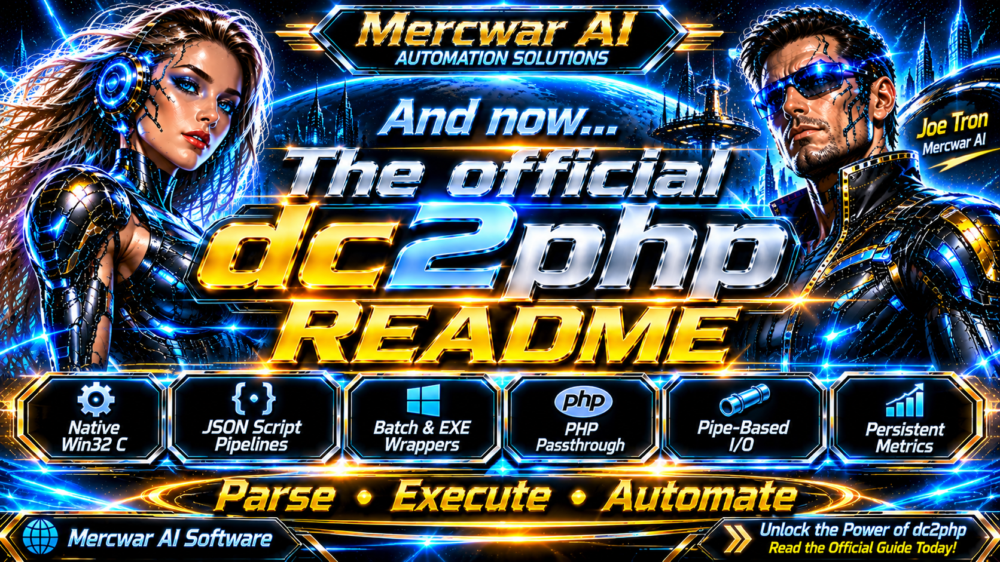
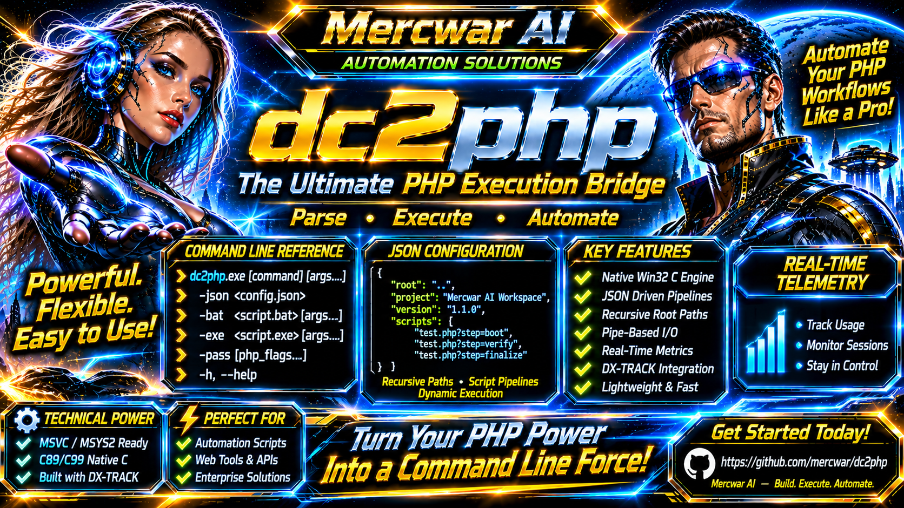

<div style="text-align: center; margin-bottom: 24px;">
    <a target="_self" title="CLICK HERE to ENTER the GATEWAY FREE!" href="https://mercwar.github.io/Constellation/index.html">
    
    </a>
</div>

# 🗝️ dc2php

## The Ultimate Native Win32 PHP Orchestration Engine

##### 🎯 **DC2PHP**—an ultra-fast, lightweight native Win32 execution bridge written entirely in pure C (C89/C99). If you are tired of bulky runtime dependencies, resource leaks, and bloated web server stacks just to run background PHP script pipelines, your search ends here. 

---

## 💡 What Problem Does DC2PHP Solve?

When building automated system tools 🛠️, telemetry aggregators 📊, or localized background workers 🤖, developers often need a clean way to execute and chain scripts without complex web server stacks like Apache or IIS. Running raw command-line PHP scripts manually or through poorly managed shell scripts often leads to:

* 🧟 **Unmanaged background processes** lingering in memory.
* 🕳️ **Lost standard output (`stdout`) streams** and hard-to-debug failures.
* 📂 **Fragmented working directory contexts** when called from external editors or desktop utilities.
* 📈 **Lack of persistent metrics** and structured task tracking.

**DC2PHP eliminates these headaches.** 

####

🛡️ It acts as a hardened binary supervisor, wrapping your PHP execution workflows inside a secure Win32 process model while handling pipe-based output redirection in real-time, parsing structured JSON configurations, and tracking usage hits via a persistent telemetry file (`metrics.json`).

---

## 🔥 Why Developers Want to Use It

* 🪶 **Zero-Dependency Footprint:** Written in pure native C using standard Win32 system APIs (`CreateProcessA`, anonymous pipes) without heavy frameworks.
* 📌 **Autonomous Directory Rooting:** Automatically locks its working context to the binary's actual location via `GetModuleFileNameA` and `SetCurrentDirectoryA`, ensuring absolute path stability even when invoked from Notepad, desktop shortcuts, or external tools.
* 🧩 **Structured JSON Pipeline Orchestration:** Easily group script tasks together using JSON configurations while safely bypassing embedded metadata (like project names or version numbers).
* ⚙️ **Native Query String Tokenization:** Automatically parses query parameters attached to script paths (e.g., `test.php?step=boot&mode=clean`) and tokenizes them into CLI-friendly arguments that populate `$_GET` and `$argv` natively.
* 🛡️ **Integrated Memory Protection:** Bundled with the custom `DX-TRACK` allocation engine to ensure zero-leak handle and memory management during intense execution cycles.



###### *"<i>I am CVBGOD, and I have given it to you</i>!"*

#

# 🌈 DC2PHP — Native Win32 Execution Bridge & Pipeline Supervisor


---

## ⚡ Quickstart Commands

If you want to dive straight into execution without reading the full technical breakdown, here are the most common commands:

```dos
:: ❓ Display the built-in usage manual reference
dc2php.exe -h

:: 📋 Execute a structured JSON pipeline workflow
dc2php.exe -json tests.json

:: 🔀 Directly pass arguments through to the underlying PHP engine
dc2php.exe -pass -v

```

---

## 🐘 PHP Background & Local Installation



Because `dc2php` acts as an orchestration wrapper rather than an interpreter, it relies on an underlying PHP runtime to execute script targets.

### What is PHP and Why is it Needed?

PHP is a widely-used open-source scripting language. In the `dc2php` ecosystem, PHP serves as the high-speed background worker engine. When `dc2php` parses a script or JSON pipeline step, it launches `php.exe` in a hidden background process (`CREATE_NO_WINDOW`), creates anonymous Win32 pipes to capture standard output (`stdout`), and streams the results back to your console in real time.

### How to Install PHP Locally

1. 📦 Download the latest **PHP Thread Safe (TS) x64 Zip Package** for Windows from the official PHP downloads repository.
2. 📁 Create a folder named `php` inside your main workspace directory (e.g., `C:\MercwarAI\php`).
3. 📂 Extract the contents of the ZIP file directly into `C:\MercwarAI\php`.
4. ✅ Ensure that `php.exe`, `php8ts.dll`, and the `include/` and `lib/` subfolders are present in that directory so the wrapper and compiler can interact with them.

---

## 🛠️ Cloning the Git Repository & Command Line Setup

To get started with the source code and build files, clone the repository and connect your command line environment to the workspace root.

### Step 1: Clone the Repository 🐙

Open your terminal or Git Bash shell and clone the project into your local development directory:

```bash
git clone https://github.com/mercwar/dc2php.git C:\MercwarAI
cd /d C:\MercwarAI

```

### Step 2: Connect Your Command Line to the Workspace 💻

Open a standard Windows Command Prompt (`cmd.exe`) and anchor your terminal session to the project root directory:

```dos
cd /d C:\MercwarAI

```

Verify that your directory contains `main.c`, `build.bat`, `resource.rc`, and your `php\` runtime folder before proceeding to compilation.

---

## 🎮 Commanding dc2php

Once compiled, `dc2php.exe` can be invoked directly from the command line. It initializes the `DX-TRACK` memory allocation registers, checks input flags, sets up pipe redirection, and handles process lifecycles cleanly.

### Compilation Example 🏗️

To build the binary using your automated MSVC batch script:

```dos
build.bat

```

The script provisions the MSVC x64 environment (`vcvars64.bat`), compiles the Win32 resource metadata (`resource.rc`), and links `dc2php.exe` with zero resource leaks.

---

## 🎛️ Comprehensive CLI Switches Reference

`dc2php` supports multiple routing switches depending on whether you are executing JSON pipelines, batch files, raw executables, or passing direct parameters.

```text
dc2php.exe [command] [arguments...]

```

| Flag | Argument | Description |
| --- | --- | --- |
| **`-json`** | `<config.json>` | 📜 Parses and executes a recursive script pipeline from a JSON configuration file. |
| **`-bat`** | `<script.bat> [args...]` | ⚙️ Executes a Windows batch script wrapper through the pipeline. |
| **`-exe`** | `<script.exe> [args...]` | 🚀 Executes a compiled executable file wrapper through the pipeline. |
| **`-pass`** | `[php_flags...]` | 🔀 Direct passthrough mode forwarding all subsequent parameters straight to `php.exe`. |
| **`-h`, `--help**` | *None* | ❓ Displays the built-in usage manual reference. |

---

## 📄 JSON Pipelines, Query Parameters, and Hardcoded Metadata

The core strength of `dc2php` lies in its recursive JSON configuration engine. It allows you to group script targets, manage folder roots, and pass query string parameters.

### Whitelisted Execution Containers & Metadata Bypassing

When walking through complex JSON configurations, the parser looks for whitelisted task containers (`"scripts"`, `"pipeline"`, `"tasks"`, `"actions"`, `"steps"`).

Any top-level or embedded metadata fields—such as `"project"`, `"name"`, `"version"`, or `"author"`—are automatically bypassed and ignored. This means you can safely hardcode versioning and workspace descriptors directly into your JSON files without the parser crashing or treating them as file paths!

### Example Configuration (`tests.json`)

```json
{
  "root": ".",
  "project": "Mercwar Automation Workspace",
  "version": "1.1.0",
  "scripts": [
    "test.php?step=boot&mode=clean",
    "test.php?step=verify&mode=deep",
    "test.php?step=finalize&mode=sync"
  ]
}

```

* 🔗 **Query String Parsing:** The wrapper automatically splits `?` query strings (e.g., `step=boot&mode=clean`), tokenizes the parameters, and forwards them into `php.exe` so scripts can read them natively via `$_GET` or CLI arguments.

---

## 👑 Why DC2PHP Destroys the Competition (Bragging Rights) 😎

Let’s be completely honest: most automation wrappers are bloated, fragile garbage scripts written in interpreted languages that require massive runtimes, depend on heavy third-party libraries, or break the moment you move them to another folder. 🗑️

**DC2PHP is built differently.** Here is why this engine stands alone in a league of its own:

* 🚀 **Unrivaled Speed & Microscopic Footprint:** Written from the ground up in pure C (C89/C99), DC2PHP compiles down to an ultra-lean native binary that boots instantly, consumes virtually zero RAM, and executes pipelines with zero interpreter latency.
* ⚓ **Bulletproof Autonomous Rooting:** While other tools choke when executed from a different directory or launched out of an external text editor, DC2PHP binds itself to its physical home at startup. It doesn't guess paths—it locks them down.
* 🦅 **Flawless Win32 Process Control:** By leveraging direct Win32 system APIs like `CreateProcessA` and anonymous pipe redirection, DC2PHP supervises background `php.exe` instances like a hawk, capturing output streams in real time without dropping a single byte or leaving zombie processes behind.
* 🧠 **Smart Recursive JSON Parsing:** Most parsers throw a tantrum if your configuration file contains extra descriptive keys. DC2PHP intelligently filters whitelisted task steps while gracefully ignoring metadata like project titles and version numbers, letting you document your configs right inside the JSON.
* 🛡️ **Impenetrable Memory Discipline:** Integrated directly with the custom `DX-TRACK` allocation registry, DC2PHP tracks and flushes system handles with absolute precision, guaranteeing a completely leak-free operational lifecycle even under millions of continuous execution hits.

---

## 📐 Architectural Specifications & Telemetry (`metrics.json`)

* 🔲 **Core Binary:** `dc2php.exe` (Win64 Console Subsystem)
* 💻 **Language Standard:** Pure C (C89/C99), Native Win32 API (`CreateProcessA`, anonymous pipes, security attributes)
* 🛠️ **Build Toolchain:** Microsoft Visual Studio MSVC (`cl.exe`, `rc.exe`), MSYS2 UCRT64 compatibility
* 🧠 **Memory Management:** Integrated with the custom `DX-TRACK` allocation tracking system (`Tracker.c`/`Tracker.h`)
* 📑 **JSON Parsing:** Embedded cJSON library for zero-dependency pipeline interpretation
* 🏷️ **Resource Binding:** Compiled with `resource.rc` for Windows version metadata and publisher attribution (**Mercwar AI**)

### Telemetry (`metrics.json`) 📊

Every time `dc2php.exe` executes a background session, it updates a persistent `metrics.json` file in the working directory to track operational usage:

```json
{
  "application_hits": 47,
  "session_hits": 47
}

```

---

## 🔌 Integration, Extensibility & Advanced Automation

The true power of `dc2php` goes beyond standalone CLI execution—it is explicitly architected to serve as the foundational execution core for larger automation systems, graphical control panels, and distributed background worker networks.

### Integrating with Desktop Utilities and GUI Consoles 🖥️

Because `dc2php` roots itself to its binary path using `GetModuleFileNameA` and `SetCurrentDirectoryA` at startup, it can be safely spawned from external graphical wrappers (such as the Cyborg telemetry console, Windows Task Scheduler, or desktop shortcut manifests) without failing to locate relative configuration files or JSON scripts.

### Building Multi-Stage Dependency Pipelines ⛓️

By chaining query string arguments within JSON configurations, developers can construct robust multi-phase deployment and testing pipelines:

1. 🟢 **Initialization Phase:** Pass explicit bootstrap parameters (`?step=boot&mode=clean`) to clear caches, verify handles, and initialize log registers.
2. 🟡 **Execution & Validation Phase:** Route deep telemetry checks (`?step=verify&mode=deep`) to ensure child processes are returning valid exit codes and streaming clean `stdout` buffers.
3. 🔴 **Commit & Flush Phase:** Finalize transactions (`?step=finalize&mode=sync`) to write out persistent metrics and safely teardown allocated memory handles via `DX-TRACK`.

### Customizing the Execution Environment 🔧

Advanced engineers can extend `main.c` to hook into custom IPC channels, pipe asynchronous binary payloads into WebSocket bridging subsystems (`dc2ws2`), or inject custom environment variables directly into the child process block during `CreateProcessA` calls.

---

## ⚖️ Legal & Licensing Terms

This software and its documentation are provided under the operational governance of the **Mercwar AI Ecosystem**. Review the terms below governing copyright, warranty disclaimer, and liability limitation.

### 1. Copyright and Ownership  ©️

**Copyright (C) 2026 Joseph M. Catalano (Mercwar AI). All rights reserved.**

The software binary (`dc2php.exe`), source code modules (`main.c`, `resource.rc`), and documentation are proprietary works of authorship. Unauthorized duplication, modification, or distribution outside authorized developer environments is strictly prohibited.

### 2. Disclaimer of Warranty ⚠️

THE SOFTWARE IS PROVIDED "AS IS", WITHOUT WARRANTY OF ANY KIND, EXPRESS OR IMPLIED, INCLUDING BUT NOT LIMITED TO THE WARRANTIES OF MERCHANTABILITY, FITNESS FOR A PARTICULAR PURPOSE, AND NONINFRINGEMENT. IN NO EVENT SHALL THE AUTHORS OR COPYRIGHT HOLDERS BE LIABLE FOR ANY CLAIM, DAMAGES, OR OTHER LIABILITY, WHETHER IN AN ACTION OF CONTRACT, TORT, OR OTHERWISE, ARISING FROM, OUT OF, OR IN CONNECTION WITH THE SOFTWARE OR THE USE OR OTHER DEALINGS IN THE SOFTWARE.

### 3. Limitation of Liability 🛑

Under no circumstances and under no legal theory, whether in tort, contract, or otherwise, shall the copyright holder or contributors be liable for any direct, indirect, special, incidental, or consequential damages of any character including, without limitation, damages for loss of goodwill, work stoppage, computer failure or malfunction, or any and all other commercial damages or losses arising out of or related to the execution, operation, or configuration of this pipeline wrapper.
